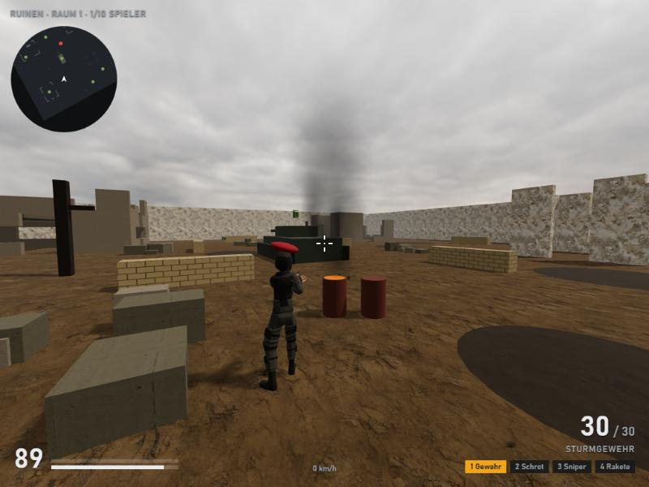
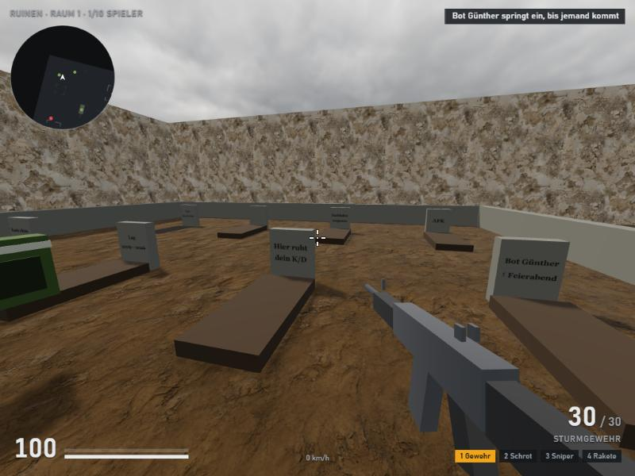

# Revier

Ein Alle-gegen-alle-Shooter, der direkt im Browser läuft. Seite öffnen, Namen eingeben,
Charakter wählen, spielen. Bis zu 10 Spieler in einem zerschossenen Dorf. Wer allein ist,
bekommt einen Bot als Gegner, auch ganz ohne Server.




"Revier" ist ein Arbeitstitel.

## Was das Spiel kann

- **Sofort spielbar.** Keine Anmeldung, kein Download. Der Name wird im Startmenü eingegeben.
- **Alle gegen alle.** Wer zuerst 20 Kills hat, gewinnt die Runde. Dann geht es von vorn los.
- **Zehn Charaktere.** Wolf, Sahara, Tundra, Dschungel, Marine, Rost, Geist, Sani, Funker, Veteran.
  Im Menü dreht sich eine 3D-Vorschau. In einem Raum trägt jeder Spieler einen anderen.
- **Räume mit 10 Plätzen.** Der elfte Spieler eröffnet einen neuen Raum.
- **Nie allein.** Ist nur ein Spieler im Raum, springt ein Bot ein. Kommt ein zweiter Mensch, geht der Bot.
- **Solo-Modus ohne Server.** Ist kein Server erreichbar, laufen dieselben Spielregeln im Browser, mit einem Bot.
- **Rangliste der Woche.** Die zehn Namen mit den meisten Kills, jeden Montag neu.
- **Eine Karte: Ruinen.** Ein Panzerwrack in der Mitte, vier zerschossene Häuser (eines mit Obergeschoss),
  ein Friedhof, Sandsäcke, Trümmer, Krater, brennende Fässer.
- **Vier Waffen.** Messer, Pistole, Maschinenpistole, Sturmgewehr. Mit dem Messer in der Hand läuft man etwas schneller.
- **Schiessen mit Gewicht.** Zielen über Kimme und Korn, Rückstoss, Magazine, weniger Schaden auf Distanz, Kopftreffer.
- **Bewegung.** Bunny Hop, Rutschen, Wandsprung. Trümmer und Treppen läuft man einfach hoch.
- **Schutzwesten** zum Einsammeln, **Minimap**, **Schulterkamera** und **Chat**.
- **Easter Eggs.** Lies die Grabsteine. Und irgendwo sitzt noch eine Ente.

## Steuerung

| Taste | Wirkung |
|---|---|
| W A S D | laufen |
| Leertaste | springen. Halten für Bunny Hop, in der Luft an einer Wand für den Wandsprung |
| Shift | ducken. Im Laufen gedrückt: rutschen |
| Linksklick | schiessen, mit dem Messer zustechen |
| Rechtsklick | zielen |
| R | nachladen |
| 1 2 3 4 | Messer, Pistole, Maschinenpistole, Sturmgewehr |
| Mausrad | Waffe wechseln |
| V | Schulterkamera ein und aus |
| Enter | Chat (nur im Mehrspieler) |
| Tab | Punktestand |
| Esc | Menü |

## Schnellstart

Voraussetzung: [Node.js](https://nodejs.org) ab Version 20.

```bash
npm install
```

```bash
npm start
```

Danach läuft das Spiel auf http://localhost:3000. Wer im selben Netz ist, kann über die
Adresse deines Rechners mitspielen.

## Auf Vercel veröffentlichen (mit Mehrspieler)

Vercel liefert die Dateien aus und führt zusätzlich den Spielserver als Funktion aus
(`api/ws.js`, eingestellt in `vercel.json`). Damit funktionieren dort Mehrspieler und Rangliste.

1. Auf [vercel.com/new](https://vercel.com/new) das GitHub-Repository auswählen.
2. Nichts umstellen und auf **Deploy** klicken.

Bei jedem Push auf `main` veröffentlicht Vercel danach von selbst neu.

Was man über Vercel wissen muss:

- **Verbindungen dauern höchstens 5 Minuten** (im kostenlosen Tarif). Das Spiel verbindet sich dann
  sofort neu und zeigt sein Kennzeichen vor. Der Spieler behält Platz, Position und Punkte.
- **Kein fester Server.** Vercel garantiert nicht, dass zwei Spieler auf derselben Instanz landen.
  Bei wenig Betrieb klappt es in der Regel. Landen zwei Freunde in getrennten Räumen, hilft neu laden.
- **Die Rangliste braucht einen Speicher.** Auf Vercel bleibt nichts auf der Festplatte. Ohne Speicher
  beginnt die Rangliste von vorn, sobald Vercel die Funktion neu startet. Siehe nächster Abschnitt.

### Rangliste dauerhaft machen (einmalig, kostenlos)

Die Rangliste soll eine Woche lang halten und am Montag neu beginnen. Dafür legt man in Vercel
einen kleinen Redis-Speicher an:

1. Im Vercel-Projekt auf **Storage** gehen und **Create Database** wählen.
2. **Upstash** (Redis) auswählen, den kostenlosen Tarif nehmen und mit dem Projekt verbinden.
3. Das Projekt einmal neu veröffentlichen (**Deployments > Redeploy**), damit die Zugangsdaten ankommen.

Mehr ist nicht nötig. Das Spiel erkennt die Zugangsdaten von selbst (`KV_REST_API_URL` und
`KV_REST_API_TOKEN`, oder `UPSTASH_REDIS_REST_URL` und `UPSTASH_REDIS_REST_TOKEN`). Jede Woche bekommt
eine eigene Liste, alte Listen löschen sich nach zwei Wochen selbst. Ob der Speicher benutzt wird,
zeigt die Adresse `/api/ws`: Dort steht dann `"store":"redis"`.

Antwortet der Server einmal nicht, fällt das Spiel von selbst in den Solo-Modus gegen einen Bot zurück.

## Wie es gebaut ist

Der Kern ist eine einzige Datei mit den Spielregeln, die an zwei Orten läuft: im Node-Server
für den Mehrspieler und im Browser für den Solo-Modus. So gibt es nur eine Wahrheit darüber,
wie Räume, Bots, Schaden und Runden funktionieren.

| Datei | Aufgabe |
|---|---|
| `public/shared.js` | Die Karte, Waffen, Bewegungsphysik, Strahl-Tests. Von Browser und Server benutzt |
| `public/sim.js` | Spielregeln: Räume, Charaktere, Bots mit Wegfindung, Schaden, Westen, Runden. Ohne Netzwerk und ohne Dateizugriff |
| `game-server.js` | Verbindet Spieler per WebSocket mit `sim.js`, führt die Rangliste, liefert lokal auch die Dateien aus |
| `board.js` | Die Rangliste der Woche: in Redis, wenn eingerichtet, sonst in einer Datei |
| `api/ws.js`, `vercel.json` | Machen aus `game-server.js` eine Funktion auf Vercel |
| `public/game.js` | Alles im Browser: 3D mit three.js, Steuerung, Schiessen, Effekte, Anzeige, Menü |
| `public/config.js` | Adresse des Mehrspieler-Servers |
| `public/index.html` | Startmenü und Anzeige |
| `test.js` | Automatischer Test |
| `tools/vendor.mjs` | Kopiert die benötigten three.js-Dateien nach `public/vendor` (läuft bei `npm install`) |

Ein paar Entscheide, die man beim Lesen wissen sollte:

- **Die Karte entsteht aus Code.** Jede Ruine ist eine Mauer in Stücken: ganz, Fenster, Stumpf oder Tür.
  Der Zufall dafür hat einen festen Startwert, damit Browser und Server genau dieselben Ruinen bauen.
- **Bewegung nach altem Shooter-Vorbild.** Die Luftbeschleunigung ist gedeckelt. Daraus entstehen Bunny Hop und Kurvenflug von selbst.
- **Der Bot sucht seinen Weg** über ein Raster aus 1-Meter-Feldern und eine Breitensuche vom Ziel aus.
- **Beide Hände am Gewehr.** Das Modell bringt nur einhändige Posen mit. Beine und Körper kommen darum aus
  seinen Animationen, die Arme werden jedes Bild neu ausgerichtet, bis die Hände am Gewehr liegen.
- **Texturen und Modell laden nach.** Zuerst erscheinen im Code gezeichnete Texturen und Figuren aus Blöcken.
  Sie werden ersetzt, sobald Fotos und Modell geladen sind, und bleiben als Reserve.
- **Der Browser meldet, der Server prüft.** Der Browser des Spielers rechnet seine Bewegung und meldet Schüsse und Treffer.
  Die Spielregeln glauben einen Treffer nur, wenn er möglich war: Der Schuss kam von dort, wo der Spieler steht, er ging
  in Richtung des Ziels, es lag nichts Festes dazwischen, die Feuerrate stimmt, und ein Messer reicht nur aus der Nähe.
  Auch der gemeldete Standort wird geprüft: nicht schneller als 18 m/s über den Boden und nicht in einer Wand.
  Die Bewegung selbst wird nicht nachgerechnet. Siehe Grenzen.

## Tests

```bash
npm test
```

Der Test startet den echten Server auf einem freien Port und prüft unter anderem:
Namen werden gesäubert, zehn Spieler bekommen zehn verschiedene Charaktere, der Bot ist nur bei
einem Spieler da, Räume fassen 10 Spieler. Treffer zählen nur nach einem Schuss vom eigenen Standort
in Richtung des Ziels, nicht durch den Panzer hindurch, und das Messer nur aus der Nähe. Die Rangliste
zählt und speichert, der Solo-Modus läuft ohne Netzwerk, Westen fangen Schaden ab, alle Spawn-Punkte
und Westen liegen frei, Grabhügel und Treppen lassen sich hochlaufen. Wer nach einer getrennten
Verbindung sein Kennzeichen vorzeigt, bekommt Platz und Punkte zurück. Die Vercel-Funktion liefert
denselben Server, ohne selbst zu starten.

## Grenzen

- **Schummeln ist erschwert, nicht ausgeschlossen.** Treffer, Tempo und Wände werden geprüft, die Bewegung wird aber
  nicht nachgerechnet. Wer sein Spiel umbaut, kann also fliegen oder perfekt zielen.
- **Namen sind keine Konten.** Jeder kann jeden Namen eintippen, also auch in der Rangliste.
- **Der Chat ist ungefiltert.** Er ist auf 80 Zeichen begrenzt und wird nur als Text angezeigt, mehr nicht.
- **Ein Körper für alle.** Die zehn Charaktere unterscheiden sich in Farben und Ausrüstung, nicht in der Figur.
- **Kein Ton aus Dateien.** Alle Geräusche werden im Browser erzeugt und klingen entsprechend schlicht.
- **Maus und Tastatur.** Für Handys und Gamepads gibt es keine Steuerung.

## Ideen für später

- Echte Aufnahmen für Schüsse, Schritte und Umgebung.
- Der Server rechnet auch die Bewegung selbst nach, damit Schummeln noch schwerer wird.
- Eigene Figuren pro Charakter statt eines gemeinsamen Körpers.
- Mehr Easter Eggs.
- Konten, damit die Rangliste verlässlich ist.

## Quellen und Lizenzen

- Texturen und Himmel: [Poly Haven](https://polyhaven.com), Lizenz CC0.
- Figur "SWAT": [Quaternius](https://quaternius.com) über [Poly Pizza](https://poly.pizza/m/Btfn3G5Xv4), Lizenz CC0.
- 3D-Bibliothek: [three.js](https://threejs.org), MIT-Lizenz.
- WebSocket-Bibliothek: [ws](https://github.com/websockets/ws), MIT-Lizenz.

Die genauen Dateien stehen in `public/assets/QUELLEN.txt`.
Für den eigenen Code ist noch keine Lizenz gewählt.
